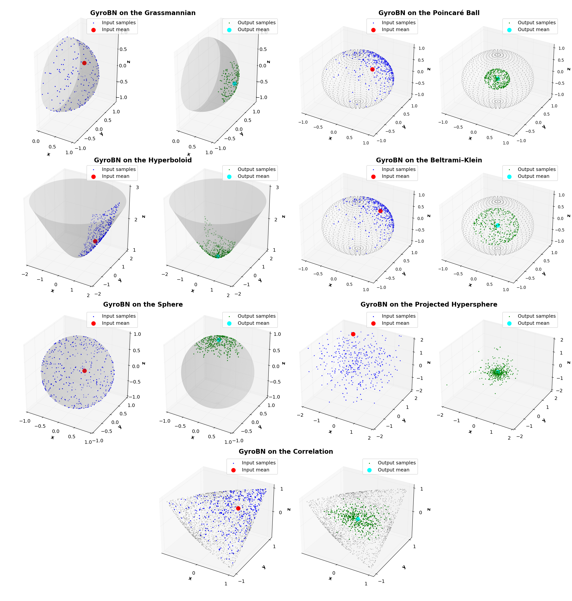

[//]: # ([</img>]&#40;https://arxiv.org/abs/2403.11261&#41;)
[</img>](https://openreview.net/forum?id=d1NWq4PjJW)
[</img>](https://openreview.net/pdf?id=d1NWq4PjJW)

# Gyrogroup Batch Normalization

<div align="center">
    
    <p align="center"><b>Figure 1:</b> Visualization of GyroBN on the Grassmannian, five constant curvature spaces, and correlation manifold.</p>
</div>

## 📖 Introduction
This is the official PyTorch implementation of:
- *Gyrogroup Batch Normalization* 
[[OpenReview](https://openreview.net/forum?id=d1NWq4PjJW)]
- *Riemannian Batch Normalization: A Gyro Approach* (Conference extension, in submission)

GyroBN provides a principled framework for batch normalization on gyrogroups, a unifying algebraic structure covering Lie groups, SPD matrices, Grassmannians, constant curvature spaces (hyperbolic, spherical, Euclidean), and correlation manifolds.

Compared to existing Riemannian normalization methods (SPDBN, LieBN, RBN, etc.), GyroBN:
- ✅ Guarantees control of mean and variance on manifold-valued data;  
- ✅ Generalizes previous methods as special cases;  
- ✅ Implements efficient, closed-form gyro operations;  
- ✅ Achieves higher accuracy, efficiency, and stability across diverse geometries

If you find this project helpful, please consider citing us as follows:

```bibtex
@inproceedings{chen2025gyrobn,
    title={Gyrogroup Batch Normalization},
    author={Ziheng Chen and Yue Song and Xiaojun Wu and Nicu Sebe},
    booktitle={ICLR},
    year={2025},
}
@article{chen2025gyrobn_extension,
  title   = {Riemannian Batch Normalization: A Gyro Approach},
  author  = {Ziheng Chen and Xiaojun Wu and Nicu Sebe},
  journal = {arXiv},
  year    = {2025},
}
```
As discussed in our main paper, GyroBN also naturally incorporates our previous [LieBN](https://github.com/GitZH-Chen/LieBN.git):
```bibtex
@inproceedings{chen2024liebn,
    title={A Lie Group Approach to Riemannian Batch Normalization},
    author={Ziheng Chen and Yue Song and Yunmei Liu and Nicu Sebe},
    booktitle={ICLR},
    year={2024},
}
```

If you have any problem, please contact me via ziheng_ch@163.com.

--- 
## ✨ Features
- General framework: plug-and-play batch normalization for pseudo-reductive gyrogroups with gyroisometric gyrations.  
- Implemented geometries:
  - Grassmannian (ONB perspective);
  - Constant curvature spaces (Poincaré ball, hyperboloid, Beltrami–Klein, sphere, projected hypersphere);
  - Full-rank correlation manifolds (Poly-Hyperbolic-Cholesky metric).
- Efficient operators: closed-form gyroaddition on the radius model, fast Grassmannian logarithm via Bendokat et al. (2024).  
- PyTorch compatible: drop-in `nn.Module` layers for manifold-valued networks.

Notes:
- By default, GyroBN uses `.detach()` when computing Fréchet statistics on the Grassmannian, following prior work (SPDNetBN, LieBN). 
- For Constant curvature spaces and correlation matrices, GyroBN sets the iteration number to 1000 by default.

## Requirements
Requierments: `torch`.

## Demos
Demos of GyroBN on different geometries can be found in `./demos`

---

